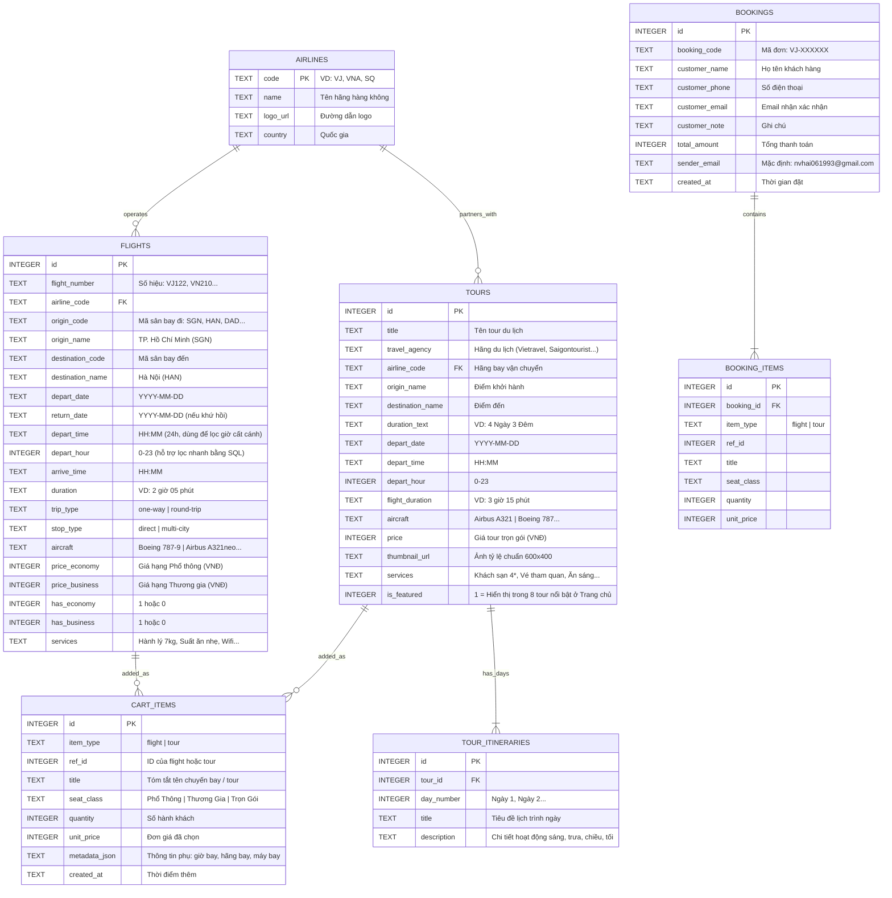

# DATABASE.md — Thiết kế Cơ sở Dữ liệu SQLite & Dữ liệu Mẫu

Toàn bộ dữ liệu của website **Vietjet** được quản lý trong cơ sở dữ liệu quan hệ **SQLite** (vận hành qua `sql.js`).

---

## 1. Sơ đồ Thực thể Quan hệ (ERD)



---

## 2. Câu lệnh SQL Khởi tạo Bảng (`CREATE TABLE`)

```sql
CREATE TABLE IF NOT EXISTS airlines (
    code TEXT PRIMARY KEY,
    name TEXT NOT NULL,
    logo_url TEXT NOT NULL,
    country TEXT
);

CREATE TABLE IF NOT EXISTS flights (
    id INTEGER PRIMARY KEY AUTOINCREMENT,
    flight_number TEXT NOT NULL,
    airline_code TEXT NOT NULL,
    origin_code TEXT NOT NULL,
    origin_name TEXT NOT NULL,
    destination_code TEXT NOT NULL,
    destination_name TEXT NOT NULL,
    depart_date TEXT NOT NULL,
    return_date TEXT,
    depart_time TEXT NOT NULL,
    depart_hour INTEGER NOT NULL,
    arrive_time TEXT NOT NULL,
    duration TEXT NOT NULL,
    trip_type TEXT NOT NULL CHECK(trip_type IN ('one-way', 'round-trip')),
    stop_type TEXT NOT NULL CHECK(stop_type IN ('direct', 'multi-city')),
    aircraft TEXT NOT NULL,
    price_economy INTEGER NOT NULL,
    price_business INTEGER NOT NULL,
    has_economy INTEGER DEFAULT 1,
    has_business INTEGER DEFAULT 1,
    services TEXT NOT NULL,
    FOREIGN KEY (airline_code) REFERENCES airlines(code)
);

CREATE TABLE IF NOT EXISTS tours (
    id INTEGER PRIMARY KEY AUTOINCREMENT,
    title TEXT NOT NULL,
    travel_agency TEXT NOT NULL,
    airline_code TEXT NOT NULL,
    origin_name TEXT NOT NULL,
    destination_name TEXT NOT NULL,
    duration_text TEXT NOT NULL,
    depart_date TEXT NOT NULL,
    depart_time TEXT NOT NULL,
    depart_hour INTEGER NOT NULL,
    flight_duration TEXT NOT NULL,
    aircraft TEXT NOT NULL,
    price INTEGER NOT NULL,
    thumbnail_url TEXT NOT NULL,
    services TEXT NOT NULL,
    is_featured INTEGER DEFAULT 1,
    FOREIGN KEY (airline_code) REFERENCES airlines(code)
);

CREATE TABLE IF NOT EXISTS tour_itineraries (
    id INTEGER PRIMARY KEY AUTOINCREMENT,
    tour_id INTEGER NOT NULL,
    day_number INTEGER NOT NULL,
    title TEXT NOT NULL,
    description TEXT NOT NULL,
    FOREIGN KEY (tour_id) REFERENCES tours(id)
);

CREATE TABLE IF NOT EXISTS cart_items (
    id INTEGER PRIMARY KEY AUTOINCREMENT,
    item_type TEXT NOT NULL CHECK(item_type IN ('flight', 'tour')),
    ref_id INTEGER NOT NULL,
    title TEXT NOT NULL,
    seat_class TEXT NOT NULL,
    quantity INTEGER NOT NULL DEFAULT 1,
    unit_price INTEGER NOT NULL,
    metadata_json TEXT,
    created_at TEXT DEFAULT CURRENT_TIMESTAMP
);

CREATE TABLE IF NOT EXISTS bookings (
    id INTEGER PRIMARY KEY AUTOINCREMENT,
    booking_code TEXT NOT NULL,
    customer_name TEXT NOT NULL,
    customer_phone TEXT NOT NULL,
    customer_email TEXT NOT NULL,
    customer_note TEXT,
    total_amount INTEGER NOT NULL,
    sender_email TEXT DEFAULT 'nvhai061993@gmail.com',
    created_at TEXT DEFAULT CURRENT_TIMESTAMP
);

CREATE TABLE IF NOT EXISTS booking_items (
    id INTEGER PRIMARY KEY AUTOINCREMENT,
    booking_id INTEGER NOT NULL,
    item_type TEXT NOT NULL,
    ref_id INTEGER NOT NULL,
    title TEXT NOT NULL,
    seat_class TEXT NOT NULL,
    quantity INTEGER NOT NULL,
    unit_price INTEGER NOT NULL,
    FOREIGN KEY (booking_id) REFERENCES bookings(id)
);
```

---

## 3. Yêu cầu Dữ liệu Mẫu (`SEED DATA`)

Khi tạo `js/seed-data.js`, cần nạp sẵn dữ liệu phong phú để mọi bộ lọc đều có kết quả kiểm thử:

1. **Bảng `airlines` (Ít nhất 6 hãng hàng không)**:
   - `VJ` — **VietJet Air** (Việt Nam)
   - `VNA` — **Vietnam Airlines** (Việt Nam)
   - `SQ` — **Singapore Airlines** (Singapore)
   - `QH` — **Bamboo Airways** (Việt Nam)
   - `TG` — **Thai Airways** (Thái Lan)
   - `KE` — **Korean Air** (Hàn Quốc)

2. **Bảng `flights` (Ít nhất 12 - 16 chuyến bay đa dạng)**:
   - Bao phủ các tuyến phổ biến: TP.HCM (`SGN`) ↔ Hà Nội (`HAN`), TP.HCM (`SGN`) ↔ Đà Nẵng (`DAD`), TP.HCM (`SGN`) ↔ Phú Quốc (`PQC`), Hà Nội (`HAN`) ↔ Singapore (`SIN`), TP.HCM (`SGN`) ↔ Bangkok (`BKK`), Hà Nội (`HAN`) ↔ Seoul (`ICN`).
   - Có đủ cả `one-way` (một chiều) và `round-trip` (khứ hồi).
   - Có đủ cả `direct` (bay thẳng) và `multi-city` (nhiều thành phố / quá cảnh).
   - Trải đều các khung giờ `depart_hour`: sáng sớm (5h), sáng (8h, 10h), chiều (14h, 16h), tối (19h, 21h).
   - Đa dạng dòng máy bay: `Airbus A321neo`, `Airbus A330-300`, `Airbus A350-900`, `Boeing 787-9 Dreamliner`, `Boeing 737 MAX 8`.
   - Giá hạng Phổ thông (`price_economy` từ `890.000` đến `4.500.000` VNĐ) và Thương gia (`price_business` từ `2.890.000` đến `12.500.000` VNĐ).

3. **Bảng `tours` (Đúng 8 tour nổi bật `is_featured = 1` ở Trang chủ, có thể thêm 2-4 tour phụ cho trang Tour)**:
   - Ảnh thumbnail chuẩn kích thước **`600x400`** (sử dụng ảnh du lịch chất lượng cao kích thước `w=600&h=400&fit=crop` kèm fallback offline).
   - Danh sách 8 tour nổi bật gợi ý:
     1. *Khám phá Đảo Ngọc Phú Quốc - Grand World - Hòn Thơm* | Vietjet Holidays | 3 Ngày 2 Đêm | `VJ` | `Airbus A321neo` | `3.990.000 ₫`
     2. *Đà Nẵng - Hội An - Bà Nà Hills Cầu Vàng* | Vietravel | 4 Ngày 3 Đêm | `VJ` | `Airbus A321` | `4.850.000 ₫`
     3. *Hà Nội - Hạ Long Du Thuyền 5 Sao - Ninh Bình* | Saigontourist | 4 Ngày 3 Đêm | `VNA` | `Boeing 787-9` | `6.490.000 ₫`
     4. *Đảo Quốc Sư Tử Singapore - Gardens by the Bay - Sentosa* | Fiditour | 4 Ngày 3 Đêm | `SQ` | `Airbus A350-900` | `11.990.000 ₫`
     5. *Bangkok - Pattaya - Đảo Coral - Chùa Bình Minh* | Vietjet Holidays | 5 Ngày 4 Đêm | `TG` | `Boeing 787-8` | `7.690.000 ₫`
     6. *Đà Lạt Ngàn Hoa - Săn Mây Cầu Đất - Puppy Farm* | BenThanh Tourist | 3 Ngày 2 Đêm | `QH` | `Airbus A320` | `3.450.000 ₫`
     7. *Seoul - Đảo Nami - Công Viên Everland Mùa Lá Đỏ* | Vietravel | 5 Ngày 4 Đêm | `KE` | `Boeing 787-9` | `16.900.000 ₫`
     8. *Nha Trang Biển Xanh - VinWonders - Đảo Điệp Sơn* | Saigontourist | 3 Ngày 2 Đêm | `VJ` | `Airbus A321neo` | `4.290.000 ₫`

4. **Bảng `tour_itineraries`**:
   - Mỗi tour có từ 3 đến 5 dòng lịch trình tương ứng với số ngày của tour (Ngày 1, Ngày 2, Ngày 3...) mô tả rõ hoạt động Sáng / Trưa / Chiều / Tối.
