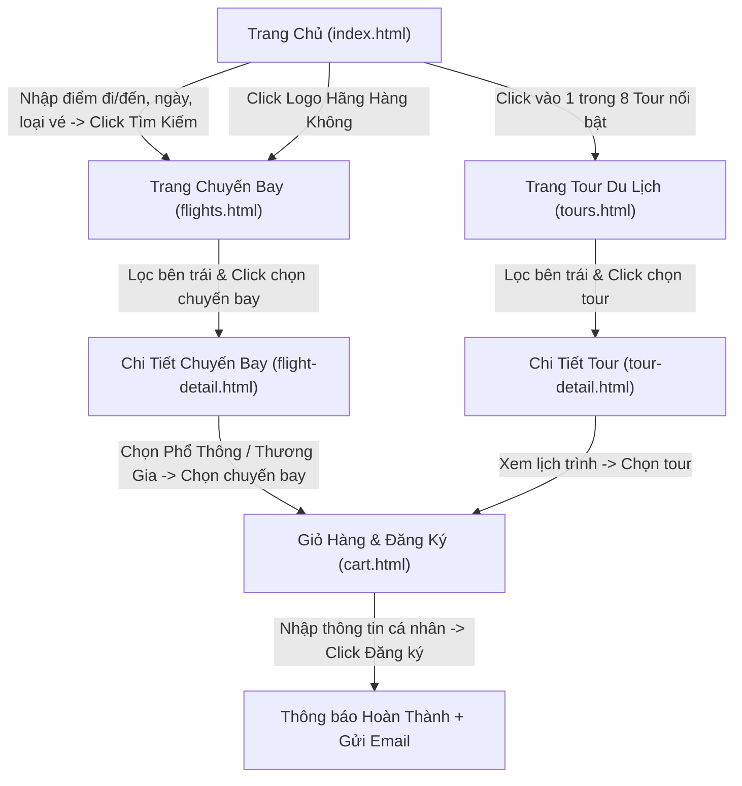

# PRD.md — Tài liệu Yêu cầu Sản phẩm (Product Requirements Document)

## 1. Giới thiệu Dự án
- **Tên sản phẩm**: **Vietjet** — Cổng thông tin đặt vé máy bay và tour du lịch trọn gói.
- **Lĩnh vực**: Du lịch & Hàng không (Travel & Aviation E-commerce).
- **Mục tiêu**: Xây dựng website thương mại điện tử du lịch trực quan, tốc độ nhanh, giao diện tông sáng với sắc đỏ đặc trưng (`#ee1d23`), vận hành hoàn toàn trên trình duyệt bằng HTML/CSS/JS thuần kết hợp cơ sở dữ liệu SQLite nội bộ và tính năng gửi email xác nhận đặt chỗ tự động.

---

## 2. Sơ đồ Luồng Người dùng (User Flow)

---

## 3. Yêu cầu Chức năng Tổng quát theo Trang

### 3.1. Trang Chủ (`index.html`)
1. **Khối Tìm kiếm Chuyến bay (Hero Search Box)**:
   - Chọn loại hành trình: **Vé khứ hồi** hoặc **Vé một chiều** (radio/tab chuyển đổi; nếu chọn một chiều thì làm mờ hoặc ẩn ô Ngày về).
   - Chọn **Điểm xuất phát** (dropdown danh sách sân bay/thành phố).
   - Chọn **Điểm đến** (dropdown danh sách sân bay/thành phố, có nút đảo chiều đi/đến).
   - Chọn **Ngày đi** (và **Ngày về** nếu vé khứ hồi).
   - Nút **Tìm Kiếm** màu đỏ `#ee1d23`: click dẫn sang trang `flights.html` kèm các tham số tìm kiếm trên URL.
2. **Khối Tour Du lịch Nổi bật**:
   - Hiển thị đúng **8 tour du lịch nổi bật** dạng lưới (Grid 4 cột trên Desktop, 2 cột trên Tablet, 1 cột trên Mobile).
   - Mỗi thẻ tour gồm: Hình thumbnail kích thước **`600x400`**, tên tour, **hãng du lịch** tổ chức, **số ngày/đêm** (VD: `4 Ngày 3 Đêm`), **giá tour**.
   - Click vào thẻ tour sẽ dẫn đến **trang Tour (`tours.html`)** (có thể truyền thêm tham số highlight/filter tour vừa chọn hoặc mở danh sách Tour).
3. **Khối Đối tác Hãng Hàng Không**:
   - Hiển thị logo các hãng bay uy tín: **VietJet Air**, **Vietnam Airlines**, **Singapore Airlines**, **Bamboo Airways**, **Thai Airways**, **Korean Air**...
   - Click vào logo hãng nào sẽ dẫn đến trang **Chuyến Bay (`flights.html?airline=<ma_hang>`)** và tự động lọc chuyến bay của hãng đó.

### 3.2. Trang Chuyến Bay (`flights.html`)
- Bố cục chia 2 cột:
  - **Bên trái (Bộ lọc - Sidebar Filter)**:
    - Sắp xếp **Giá vé**: Tăng dần / Giảm dần.
    - **Loại vé**: Vé khứ hồi, Vé một chiều.
    - **Loại hành trình / Điểm dừng**: Bay thẳng, Nhiều thành phố (nối chuyến).
    - **Các hãng hàng không**: Checkbox chọn 1 hoặc nhiều hãng (VietJet Air, Vietnam Airlines, Singapore Airlines...).
    - **Thời gian cất cánh (giờ)**: Khung giờ Sáng sớm (`00:00 - 06:00`), Buổi sáng (`06:00 - 12:00`), Buổi chiều (`12:00 - 18:00`), Buổi tối (`18:00 - 24:00`).
    - **Hạng dịch vụ**: Hạng Phổ thông, Hạng Thương gia.
  - **Bên phải (Danh sách kết quả)**:
    - Hiển thị danh sách chuyến bay khớp bộ lọc: Logo & tên hãng, điểm đi → điểm đến, **ngày cất cánh**, **thời gian bay** (giờ đi - giờ đến & tổng thời lượng), **dịch vụ** đi kèm (hành lý xách tay/ký gửi, suất ăn, giải trí...), **giá tiền**.
    - Click chọn chuyến bay sẽ dẫn đến trang **Chi tiết chuyến bay (`flight-detail.html?id=...`)**.

### 3.3. Trang Chi Tiết Chuyến Bay (`flight-detail.html`)
- Hiển thị thông tin chuyến bay: **Điểm đi**, **Điểm đến**, **Thời gian bay** (ngày bay, giờ cất cánh, giờ hạ cánh, tổng giờ bay), **Hãng bay**, **Loại máy bay** (ví dụ: `Airbus A321neo`, `Boeing 787-9 Dreamliner`, `Airbus A350-900`...).
- **Khu vực Chọn Giá Vé (2 thẻ hạng vé song song)**:
  - **Hạng Phổ Thông (Economy)**: Hiển thị giá phổ thông + danh sách quyền lợi (7kg hành lý xách tay, phí đổi vé tiêu chuẩn...).
  - **Hạng Thương Gia (Business)**: Hiển thị giá thương gia + danh sách quyền lợi cao cấp (18kg xách tay + 30kg ký gửi, phòng chờ VIP, suất ăn nóng, ưu tiên làm thủ tục...).
- Nút **Chọn chuyến bay**: Lưu chuyến bay cùng hạng vé & mức giá đã chọn vào **Giỏ Hàng** (bảng `cart_items` trong SQLite), hiển thị thông báo thành công và cho phép chuyển nhanh sang trang Giỏ Hàng.

### 3.4. Trang Tour (`tours.html`)
- Bố cục chia 2 cột:
  - **Bên trái (Bộ lọc - Sidebar Filter)**:
    - Sắp xếp **Giá vé/tour**: Tăng dần / Giảm dần.
    - **Các hãng hàng không**: Checkbox chọn hãng bay vận chuyển trong tour.
    - **Thời gian cất cánh (giờ)**: Lọc theo khung giờ bay khởi hành của tour (`00:00 - 06:00`, `06:00 - 12:00`, `12:00 - 18:00`, `18:00 - 24:00`).
  - **Bên phải (Danh sách Tour)**:
    - Hiển thị các tour du lịch: Ảnh thumbnail `600x400`, tên tour, hãng lữ hành, **hãng bay**, **ngày cất cánh**, **thời gian bay** (giờ bay & số ngày/đêm), **dịch vụ** (khách sạn 4-5*, xe đưa đón, vé tham quan, bảo hiểm...), **giá tiền**.
    - Click chọn tour sẽ dẫn đến trang **Chi tiết Tour (`tour-detail.html?id=...`)**.

### 3.5. Trang Chi Tiết Tour (`tour-detail.html`)
- Hiển thị thông tin chi tiết: Hình ảnh tour, tên tour, hãng du lịch, số ngày/đêm, giá trọn gói.
- Thông tin chuyến bay đi kèm: **Điểm đi**, **Điểm đến**, **Thời gian bay**, **Hãng bay**, **Loại máy bay** (Boeing, Airbus...).
- **Lịch trình chuyến đi**: Trình bày chi tiết theo từng ngày (Ngày 1, Ngày 2, Ngày 3...) bao gồm các điểm tham quan, bữa ăn và khách sạn nghỉ ngơi.
- Nút **Chọn tour**: Lưu tour vào **Giỏ Hàng** (SQLite `cart_items`), cập nhật số lượng trên icon Giỏ Hàng và thông báo xác nhận.

### 3.6. Trang Giỏ Hàng (`cart.html`)
- **Danh sách đã chọn**:
  - Hiển thị đầy đủ các **Chuyến bay** và **Tour du lịch** khách hàng đã thêm vào giỏ hàng (phân loại rõ nhãn `Chuyến bay` / `Tour`, hành trình, ngày đi, hạng vé, số lượng khách, thành tiền).
  - Có nút **Xóa từng mục** và nút **Xóa toàn bộ giỏ hàng**, tự động tính lại Tổng thanh toán.
- **Form Nhập Thông tin Cá nhân**:
  - Họ và tên khách hàng (bắt buộc).
  - Số điện thoại liên hệ (bắt buộc, kiểm tra định dạng SĐT).
  - Địa chỉ **Email khách hàng** (bắt buộc, kiểm tra định dạng email để nhận thư xác nhận).
  - Địa chỉ / Ghi chú yêu cầu đặc biệt (tùy chọn).
- **Xử lý nút Đăng ký**:
  1. Kiểm tra giỏ hàng không rỗng và dữ liệu form hợp lệ.
  2. Lưu thông tin đơn đặt chỗ vào bảng `bookings` và `booking_items` trong SQLite, sau đó xóa giỏ hàng hiện tại.
  3. **Gửi Email xác nhận** từ địa chỉ `nvhai061993@gmail.com` đến địa chỉ email của khách hàng (chứa mã đơn hàng, thông tin hành khách, danh sách chuyến bay/tour đã đặt và tổng tiền).
  4. Hiển thị **Thông báo hoàn thành** (Modal chúc mừng đặt chỗ thành công kèm tóm tắt đơn hàng).
